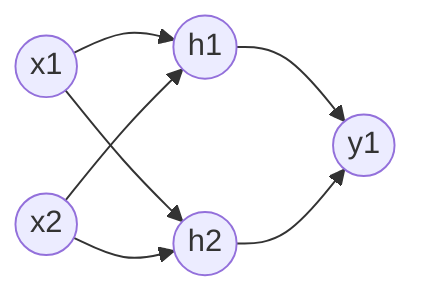

# 神经网络基础：从神经元到 CNN / TCN

> 面向刚接触深度学习的人：先建立**系统的概念地图**，再理解各种网络为什么长成那样。
> 这是 [ESP32-TinyML](https://github.com/yh-xh/ESP32-TinyML) 的公共基础篇之一；
> 模型如何量化、装进 MCU 见 [basics.md](https://github.com/yh-xh/ESP32-TinyML/blob/main/basics.md)。

---

## 目录

- [1. 从神经元说起](#1-从神经元说起)
- [2. 激活函数](#2-激活函数)
- [3. 层、算子、模型](#3-层算子模型)
- [4. 全连接神经网络（MLP）](#4-全连接神经网络mlp)
- [5. 卷积神经网络（CNN）](#5-卷积神经网络cnn)
- [6. 时序网络：RNN → LSTM → TCN](#6-时序网络rnn--lstm--tcn)
- [7. 训练与推理](#7-训练与推理)
- [8. 概念对照：论文里的名字 vs 端侧框架里的实现](#8-概念对照论文里的名字-vs-端侧框架里的实现)
- [9. 学习顺序建议](#9-学习顺序建议)
- [10. 术语速查](#10-术语速查)

---

## 1. 从神经元说起

**一个人工神经元**受生物神经元启发，做三件事：

1. 接收多个输入 `x1, x2, …, xn`；
2. 每个输入乘一个**权重** `w`，全部加起来，再加一个**偏置** `b`；
3. 把结果送进**激活函数** `f`，得到输出。

```
x1 --w1--\
x2 --w2---Σ--(+b)-- f --> y
x3 --w3--/
```

数学写法：

```
y = f( w1·x1 + w2·x2 + … + wn·xn + b )
```

三个参数/概念的作用：

| 名称 | 通俗理解 | 数学作用 |
|---|---|---|
| **权重 w** | 每个输入有多重要 | 放大/缩小/翻转输入 |
| **偏置 b** | 神经元的"门槛" | 平移激活函数 |
| **激活函数 f** | 决定神经元"要不要兴奋" | 引入**非线性** |

一个神经元本质上就是**一次加权求和 + 一个非线性变换**。单独一个神经元只能画一条直线（线性分类），
它的威力来自**大量神经元叠成层、层叠成网络**。

## 2. 激活函数

**为什么必须有非线性？**

如果没有激活函数（或只用线性的），多层网络叠加起来仍然等价于**一层线性变换**——
`W2(W1x) = (W2W1)x`。加多少层都没用。激活函数就是让网络能拟合**弯曲的边界和复杂的函数**。

常见激活函数：

| 名称 | 公式 | 输出范围 | 特点 / 端侧情况 |
|---|---|---|---|
| **ReLU** | `max(0, x)` | `[0, +∞)` | 最常用、最便宜（一个比较） |
| **LeakyReLU** | `max(αx, x)` | `(-∞, +∞)` | 防止负半轴"死亡" |
| **Sigmoid** | `1 / (1 + e^-x)` | `(0, 1)` | 早期常用，指数运算贵；多用于二分类输出 |
| **Tanh** | `(e^x - e^-x)/(e^x + e^-x)` | `(-1, 1)` | 零中心，RNN 常用；同样较贵 |
| **SiLU / Swish** | `x · sigmoid(x)` | `(-∞, +∞)` | 现代模型常用，端侧靠查表实现 |
| **Softmax** | `e^xi / Σ e^xj` | `(0,1)` 且和为 1 | **输出层**用，把分数变成概率 |

端侧经验：

- ReLU 几乎不花钱；sigmoid/tanh/SiLU 在 MCU 上用 **LUT（查表）** 近似（esp-dl 默认开 `lut_optimization`）；
- 模型里 90% 的激活都是 ReLU 或 SiLU；
- `Softmax` 通常放在**最后一层**，把 logits 变成各类概率。

**为什么激活函数的导数很重要**

训练时梯度要穿过激活函数，它的导数决定"信号能传回去多少"：

| 激活函数 | 导数 | 含义 |
|---|---|---|
| ReLU | `1`（x>0），`0`（x<0） | 正区间梯度原样通过；负区间梯度为 0（"神经元死亡"） |
| Sigmoid | `σ(x)(1 - σ(x))`，最大 0.25 | 饱和区导数趋近 0 → 梯度消失 |
| Tanh | `1 - tanh²(x)`，最大 1 | 同样会饱和 |
| SiLU | `σ(x) + x·σ(x)(1-σ(x))` | 负区间有非零梯度，比 ReLU 平滑 |

这也解释了两件事：

- **为什么 Sigmoid/Tanh 堆深了难训**：每层导数 ≤ 0.25 / 1，多层连乘后梯度指数级衰减；
- **为什么现代网络偏爱 ReLU/SiLU**：正区间导数恒为 1，梯度能穿过很深的网络。

`Softmax` 通常只放在输出层；而且 `Softmax + CrossEntropy` 的梯度会化简成 `p - y`，
既稳定又便宜，这也是分类任务的标准组合。

## 3. 层、算子、模型

这三个词经常混着用，但含义不同：

| 概念 | 含义 | 例子 |
|---|---|---|
| **层（layer）** | 结构概念：一组按某种方式连接的神经元 | 全连接层、卷积层、池化层 |
| **算子（operator）** | 计算概念：一次具体的数学运算 | `Conv`、`Gemm`、`Add`、`ReLU` |
| **模块（module）** | 实现概念：框架里的一段代码 | esp-dl 的 `Conv` 类、TFLM 的 `Conv2D` kernel |

关系：**一个"层"在框架里可能由多个"算子"实现**，也可能被**融合**成一个算子：

```
Conv(卷积) + Bias(加偏置) + ReLU(激活)  →  融合成一个 Conv kernel
```

融合的好处：中间结果不用写回内存，少一次读写 —— 对内存带宽紧张的 MCU 非常重要。

**模型（model）** = 一堆算子按有向图连接起来 + 每个算子的权重。
训练得到的是**权重**；结构（用了哪些算子、怎么连）是人设计的。

## 4. 全连接神经网络（MLP）

**全连接层（Fully Connected / Dense / Linear / Gemm）**：每个输入神经元都和每个输出神经元相连。
以最简单的 2 → 2 → 1 为例（每条线 = 一个权重）：



> 真实网络每层有几十到几百个节点，而且**每个输入都连到每个输出**（连线数 = 输入数 × 输出数），
> 全部画出来会非常密。用下面的矩阵形式理解更清楚。

**换成矩阵更容易理解**：一层全连接就是一次矩阵乘法 `y = W·x + b`。
"全连接"的意思是——**输出向量里的每个数，都由输入向量的全部元素加权求和得到**：

```
x = [x1, x2, x3]ᵀ                 输入（3 维）

    ┌ w11 w12 w13 ┐               W：2×3 矩阵
W = │             │               每行对应一个输出，
    └ w21 w22 w23 ┘               每行有 3 个权重

y = [ w11·x1 + w12·x2 + w13·x3 + b1 ]   ← y1
    [ w21·x1 + w22·x2 + w23·x3 + b2 ]   ← y2
```

- `W` 的形状是 `[输出数, 输入数]`；
- **参数量** = `输入数 × 输出数 + 输出数`（bias）。

**多层感知机（MLP）** 就是"输入层 → 若干隐藏层 → 输出层"的堆叠，是最早、最基础的神经网络。
理论上，**足够宽的非线性 MLP 可以逼近任何连续函数**（万能近似定理）——但"能逼近"不等于
"容易训练/参数省"，所以图像、时序任务会有专门的网络结构。

### 4.1 反向传播：一层是怎么更新的

训练时，损失 `L` 对某一层权重的梯度是这样来的（链式法则）：

```
z = W·x + b                          前向：线性变换
y = f(z)                             前向：激活
δ = ∂L/∂z = (∂L/∂y) ⊙ f'(z)         误差项（⊙ 表示逐元素乘）
∂L/∂W = δ · xᵀ                       权重梯度
∂L/∂b = δ                            偏置梯度
W ← W − η · δ · xᵀ                   梯度下降更新（η = 学习率）
```

多层叠加时，误差从后往前一层层传：

```
δ_l = (W_{l+1}ᵀ · δ_{l+1}) ⊙ f'(z_l)
```

**这就是"梯度消失 / 爆炸"的来源**：每回传一层都要乘一次 `Wᵀ` 和 `f'`，
十几层连乘后梯度可能指数级缩小（消失）或放大（爆炸）。
ReLU（正区间 `f'=1`）、残差连接、BatchNorm 都是为了让这条连乘路径更稳定。

**例子：esp-dl 的 sin 模型**

`esp-dl/examples/tutorial/how_to_quantize_model/quantize_sin_model/` 就是一个 MLP：

```
1 → 64 → 64 → 1，ReLU，拟合 y = sin(x)
```

参数量只有 4353 个 float（约 17 KB），量化后 18 KB —— 非常适合 MCU。

**MLP 的局限**：

- 不利用输入的空间结构（图像相邻像素的关系被当成互不相关的数）；
- 参数量随输入尺寸爆炸：`224×224×3` 的图接一层 1000 个神经元 = `150,528 × 1000 ≈ 1.5 亿` 参数。

这就是 CNN 出现的原因。

## 5. 卷积神经网络（CNN）

### 5.1 核心思想：用一个小窗口在输入上滑动

**卷积核（kernel / filter）** 是一个小矩阵（例如 `3×3`），就是一组**共享的权重**。
把它在输入上从左到右、从上到下滑动，每到一个位置就和对应的输入块做**点积**，得到输出图上的一个点：

先看**其中一个位置**怎么算。把 3×3 的核盖在输入左上角，对应位置相乘再相加：

```
输入（5×5）              卷积核（3×3）
1 1 1 0 0               1 0 1
0 1 1 1 0               0 1 0
0 0 1 1 1               1 0 1
0 0 1 1 0
0 1 1 0 0

取左上角 3×3 的块，和卷积核逐元素相乘：

  1 1 1       1 0 1
  0 1 1   ·   0 1 0   = 1×1 + 1×0 + 1×1
  0 0 1       1 0 1     + 0×0 + 1×1 + 1×0
                        + 0×1 + 0×0 + 1×1
                      = 4        ← 输出特征图的左上角第一个点
```

然后核向右（或向下）移动一格（步长 stride），重复同样的计算，直到扫完整张图 ——
5×5 输入配 3×3 核、stride=1、无填充，就得到一张 **3×3 的输出特征图**。

> **一个容易被忽略的细节**：数学上的"卷积"会把核翻转 180°，而深度学习框架里的 `Conv`
> 实际做的是**互相关（cross-correlation）**——核不翻转。因为权重是学出来的，翻不翻转等价，
> 工程上就都直接叫卷积了。

**为什么这样设计？**

1. **局部性**：图像里有用的模式（边缘、纹理）都是局部出现的，不需要让每个像素和所有像素相连；
2. **权重共享**：同一个卷积核扫过整张图 —— 一个"边缘检测器"在哪都能用。
   参数量从 `H×W×C_in×C_out` 降成 `k×k×C_in×C_out`；
3. **平移不变性**：同样的模式出现在图像不同位置，都被同一个核检测到。

### 5.2 必懂的五个参数

| 名称 | 含义 | 直觉 |
|---|---|---|
| **通道 channel** | 输入的"深度" | RGB 图有 3 个通道；中间层有几十~几百个 |
| **特征图 feature map** | 卷积的输出 | 一个卷积核输出一张图，"这个核检测到了什么" |
| **步长 stride** | 每次滑动的格数 | stride=2 → 输出尺寸减半 |
| **填充 padding** | 在边缘补零 | 让输出和输入尺寸一致、边缘信息不丢 |
| **感受野 receptive field** | 输出某一点"看到"的输入范围 | 层越深、核越大、膨胀越大，感受野越大 |

**先把符号认全**（这些就是卷积层的"旋钮"）：

| 符号 | 含义 | 典型值 |
|---|---|---|
| `H_in` / `W_in` | 输入的高 / 宽 | 32 / 32 |
| **`k`** | **卷积核边长**（kernel size）；非方形核写作 `k_h × k_w` | 3（即 3×3 的核） |
| `padding` | 图像每边补零的圈数 | 1 |
| `stride` | 卷积核每次滑动的格数 | 1 或 2 |
| `dilation` | 核内采样间隔（膨胀率）；普通卷积为 1 | 1 |
| `C_in` / `C_out` | 输入 / 输出通道数 | 3 / 16 |
| `groups` | 分组数；普通卷积 = 1，depthwise 卷积 = `C_in` | 1 |
| `H_out` / `W_out` | 输出的高 / 宽（由公式算出） | 32 / 32 |

**输出尺寸**（除法向下取整，因为窗口不能超出图像边缘）：

```
H_out = floor( (H_in + 2×padding - dilation×(k-1) - 1) / stride ) + 1
W_out = floor( (W_in + 2×padding - dilation×(k-1) - 1) / stride ) + 1
```

**代入一个具体例子**：输入 32×32×3，3×3 核（`k=3`），`padding=1`，`stride=1`，`dilation=1`：

```
H_out = (32 + 2×1 - 1×(3-1) - 1) / 1 + 1
      = 32 + 2 - 2 - 1 + 1
      = 32
```

输出就是 **32×32×16**（`C_out=16`，高宽不变）。如果 `stride=2`：
`(32+2-2-1)/2 + 1 = 15.5 → floor 15 + 1 = 16`，输出变成 16×16。

**计算量（MAC 数）**：MAC = 一次乘加（乘一次、加一次）。

```
MACs ≈ H_out × W_out × C_out × (C_in / groups) × k × k
```

代入上面的例子（`C_in=3`，`C_out=16`，`groups=1`）：

```
MACs = 32 × 32 × 16 × (3/1) × 3 × 3
     = 442,368 ≈ 0.44 M MAC ≈ 0.88 MFLOPs
```

> 记住这个公式，就能解释为什么"输入从 640 降到 320，耗时降到 1/4"：
> `H_out`、`W_out` 各减半，乘积变成 1/4。

### 5.3 常一起出现的层

| 层/算子 | 作用 |
|---|---|
| **Conv2D** | 标准卷积（提取特征） |
| **Depthwise Conv** | 每个通道单独卷积（MobileNet 的核心，计算量小很多） |
| **1×1 Conv** | 只做通道混合，用来升/降维（Pointwise Conv） |
| **MaxPool / AvgPool** | 下采样，减小尺寸、增加感受野（详见 5.6） |
| **Global Average Pooling** | 把整张特征图压成一个数/类，替代全连接（详见 5.6） |
| **BatchNorm** | 训练稳定化；推理时可**融合进卷积**（不增加运行时开销） |
| **Concat** | 把多个特征图在通道维拼接 |
| **Residual（残差）** | `y = x + f(x)`，让深层网络好训练（ResNet） |

### 5.4 经典结构与端侧选择

| 网络 | 年代 | 关键点 | 端侧 |
|---|---|---|---|
| LeNet | 1998 | 最早的 CNN（手写数字） | 历史意义 |
| AlexNet / VGG | 2012~2014 | 加深网络 | 参数大，不适合 MCU |
| **MobileNet** | 2017 | **深度可分离卷积**，参数量/计算量大幅下降 | 端侧主力 backbone |
| **ResNet** | 2015 | 残差连接 | 常用 backbone |
| **YOLO** | 2016~ | 单阶段目标检测 | P4 上跑 YOLOv8n（秒级） |

**端侧判断标准**：看**计算量（FLOPs/MACs）**和**内存占用**，不是看参数量。
一个"参数量小但计算量大"的模型（比如高分辨率输入）在 MCU 上依然很慢。

### 5.5 深入一点：几个常被问到的数学细节

**① 参数量**

```
标准卷积：k × k × C_in × C_out + C_out        （+ bias）
```

其中 `k` 是卷积核边长，`C_in`/`C_out` 是输入/输出通道数（符号含义见 5.2 的符号表）。

**② 深度可分离卷积为什么省**

MobileNet 把标准卷积拆成两步：

```
标准卷积：     k² · C_in · C_out
深度可分离：   深度卷积 k² · C_in  +  逐点卷积 C_in · C_out
两者比值 ≈ 1/C_out + 1/k²
```

`k=3, C_out=64` 时约 **1/9** —— 这就是 MobileNet 能在 MCU 上跑的原因。

**③ BatchNorm 在推理时会被"折叠"**

训练时 `y = γ·(x-μ)/σ + β`；推理时 μ/σ/γ/β 都是固定值，可以等价地折进卷积：

```
W' = W · γ/σ
b' = (b - μ)·γ/σ + β
```

所以推理阶段 **BN 不增加任何计算**——你在 `.espdl`/`.tflite` 里看到的 Conv 往往已经融合了 BN。

**④ 残差连接为什么能救深层网络**

```
y = x + f(x)
∂L/∂x = ∂L/∂y · (1 + ∂f/∂x)
```

括号里的 `1` 提供了一条**梯度直通路径**：即使 `∂f/∂x` 很小，梯度也能沿 `1` 传回去。
这就是 ResNet 能堆到上百层的关键。

**⑤ 感受野的递推**

```
RF_0 = 1
RF_l = RF_{l-1} + (k_l - 1) × ∏_{i<l} s_i
```

层数越深、核越大、前面的 stride 越大，感受野越大。但 stride 会降低分辨率，
所以 TCN 更爱用 **dilation**（见下一节）。

### 5.6 池化（Pooling）：用一个小窗口做"聚合"

卷积是"加权求和 + 激活"；池化更简单：**在一个小窗口里做一次聚合（取最大或取平均），输出一个数**，
而且**没有任何可学习的参数**。

**Max Pooling（最大池化）**

对一个 `k×k` 窗口取最大值，窗口按 `stride` 滑动（通常 `stride = k`，窗口不重叠）：

```
输入 4×4                     2×2 窗口、stride=2
1  3  2  4
5  7  6  8        →          5  8
9  2  4  1                   9  8
3  6  8  0
```

- 公式：`y = max(x_window)`；
- 直觉：保留该区域**最强的响应**（边缘、纹理），弱响应被抑制；
- 反向传播：梯度只回传给窗口内**最大值所在的位置**（argmax 路由），其余位置梯度为 0。

**Average Pooling（平均池化）**

- 公式：`y = (1/k²)·Σ x_window`；
- 更平滑，保留区域的整体强度；
- 反向传播：梯度**平均分给**窗口内所有位置（各 `1/k²`）。

**Global Average Pooling（GAP，全局平均池化）**

- 对一个通道的**所有空间位置**取平均 → 输出一个 `[C]` 向量；
- 常放在分类网络最后，**替代全连接层**：GAP 本身无参数，分类头参数量从
  `H×W×C×类别数` 降到 `C×类别数`；
- 典型结构：`Conv… → GAP → FC → Softmax`（MobileNet/ResNet 的分类头）。

**输出尺寸与计算量**

```
H_out = floor((H_in + 2p - k) / s) + 1
```

其中 `k` = 窗口边长、`p` = padding、`s` = stride（dilation = 1 时）。

典型配置 `k=2, s=2, p=0` → 尺寸减半。计算量约为 `H_out·W_out·C·k²` 次比较/加法
（每个通道独立，不做通道混合），远小于卷积的 `H_out·W_out·C_out·C_in·k²`。

**三种池化对比**

| | Max Pooling | Average Pooling | Global Average Pooling |
|---|---|---|---|
| 输出 | 窗口最大值 | 窗口平均值 | 整个通道的均值 |
| 参数 | 无 | 无 | 无 |
| 作用 | 保留显著特征 | 平滑、保留整体强度 | 分类头降维 |
| 反传 | 只给 argmax 位置 | 均分给窗口 | 均分给整个通道 |
| 量化 | **最省心**（输入输出同 scale） | 需 int32 累加后除，可能有 ±1 LSB 舍入 | 同上 |
| 典型位置 | 早期 backbone | 过渡层 / SE 模块 | 分类头 |

**为什么有池化，也有 stride 卷积？**

两者都能下采样、都能扩大感受野：

- 池化：**无参数、计算便宜**，MaxPool 在量化时最干净；
- stride 卷积：**可学习**，更灵活（ResNet 等现代网络常用 stride=2 的卷积代替池化）；
- 端侧两者都常见，选哪个取决于网络设计和算子支持。

**端侧视角**

- 池化不增加模型体积；GAP 能替代大尺寸全连接层，显著省参数和内存；
- esp-dl 的 `dl/module` 里有 `MaxPool`、`AveragePool`、`GlobalAveragePool` 的实现，
  TFLM 里对应 `MaxPool2D` / `AveragePool2D` 算子；
- 池化的 `k`/`s` 也会计入 5.5 的感受野递推公式。

## 6. 时序网络：RNN → LSTM → TCN

MLP 和 CNN 处理的是"一张图/一个样本"。很多任务输入是**序列**：
IMU 手势 `[200, 3]`、语音帧、传感器波形。序列的特点是**前后有关联**，需要"记忆"。

### 6.1 RNN（循环神经网络）

```
h_t = tanh(W_x·x_t + W_h·h_{t-1} + b)
y_t = W_y·h_t
```

每个时间步读一个输入 `x_t`，同时把上一步的隐状态 `h_{t-1}` 传进来 —— 这就是"记忆"。

**问题**：序列一长，反向传播的梯度会消失/爆炸，学不到长期依赖；而且**必须按时间串行计算**，
在 MCU 上很难并行、速度慢。

**为什么梯度会消失**：把整个序列展开后，反向传播（BPTT）的梯度是一个连乘：

```
∂L/∂h_1 = ∏_{t=2..T} (W_hᵀ · diag(tanh'(z_t))) · ∂L/∂h_T
```

`W_h` 的特征值若普遍小于 1，连乘后趋于 0（消失）；大于 1 则爆炸。

### 6.2 LSTM / GRU

LSTM 用**门控**（遗忘门、输入门、输出门）控制"记什么、忘什么"，GRU 是它的简化版。
它们能学到更长的依赖，但计算和内存开销比简单 RNN 更大，端侧一般用于中小规模任务。

简化写法：

```
f_t = σ(W_f·[h_{t-1}, x_t] + b_f)       遗忘门：丢掉多少旧记忆
i_t = σ(W_i·[h_{t-1}, x_t] + b_i)       输入门：写入多少新信息
g_t = tanh(W_g·[h_{t-1}, x_t] + b_g)    候选记忆
o_t = σ(W_o·[h_{t-1}, x_t] + b_o)       输出门：输出多少
c_t = f_t ⊙ c_{t-1} + i_t ⊙ g_t         细胞状态（记忆）
h_t = o_t ⊙ tanh(c_t)                   隐状态（输出）
```

关键在 `c_t = f_t ⊙ c_{t-1} + …`：对 `c` 的梯度走的是**加法**而不是连乘，
所以能穿过很多时间步。GRU 把遗忘门和输入门合并成一个"更新门"，参数更少。

### 6.3 TCN（Temporal Convolutional Network，时间卷积网络）

TCN 用 **1D 卷积**处理序列，关键有三个设计：

1. **因果卷积（causal）**：只看过去、不看未来（左边补零），保证推理时不"偷看"；
2. **膨胀卷积（dilated）**：卷积核按间隔 `d` 采样，`d` 逐层翻倍（1, 2, 4, 8…），
   用很少的层获得很大的感受野；
3. **残差连接**：让深层的 TCN 好训练。

感受野例子（kernel=3，dilation=1,2,4,8）：

```
RF = 1 + Σ (k-1)×d = 1 + 2×(1+2+4+8) = 31 个时间步
```

注意 **dilation（膨胀）和 stride（步长）不是一回事**：

- `stride`：改变输出采样密度（分辨率下降）；
- `dilation`：不改变分辨率，只是让卷积核"跳着看"，用同样的参数量扩大感受野。

TCN 主要靠 dilation（配合残差）获得长记忆，而不是靠 stride 降分辨率。

**TCN vs RNN/LSTM 对比**：

| 维度 | RNN / LSTM | TCN |
|---|---|---|
| 计算方式 | 按时间串行 | **可并行**（整段序列一起卷积） |
| 长依赖 | 靠隐状态，易梯度消失 | 靠膨胀卷积，感受野可控 |
| 训练稳定性 | 较差 | 较好 |
| 端侧实现 | 状态维护复杂 | **就是 1D 卷积**，算子支持好 |
| 内存 | 需要保存隐状态 | 中间特征图较大 |

**端侧建议**：时序任务优先考虑 **1D CNN / TCN**（计算规整、易量化、算子通用）；
LSTM 只在任务确实需要强记忆时用。

> 顺带：很多端侧框架把 1D 卷积当作 `H=1` 的 2D 卷积实现；esp-dl 的 Conv 模块支持
> 1D/2D 输入（3D/4D 张量），C5 笔记里的手势 CNN 就是 1D 卷积。

### 6.4 一张表看懂 MLP / CNN / TCN

| | MLP（全连接） | CNN（2D） | TCN（1D） |
|---|---|---|---|
| 输入 | 一维特征向量 | 图像 `[H,W,C]` | 序列 `[T,C]` |
| 核心运算 | 矩阵乘 | 2D 卷积 | 1D 膨胀卷积 |
| 权重共享 | 无 | 有（核滑动） | 有 |
| 并行性 | 好 | 好 | 好（整段并行） |
| 典型任务 | 分类、回归、传感器 | 图像分类/检测 | 手势、语音、时序预测 |
| 端侧典型模型 | sin MLP、手势小网络 | MobileNet、YOLO | 手势 TCN、关键词唤醒 |

## 7. 训练与推理

两者的区别在 [basics.md](https://github.com/yh-xh/ESP32-TinyML/blob/main/basics.md) 里讲过，
这里补几个训练时的常用词：

| 术语 | 含义 |
|---|---|
| **损失函数 Loss** | 衡量预测和真值差多少（MSE、交叉熵） |
| **梯度 Gradient** | 损失对每个权重的"责任大小" |
| **反向传播 Backprop** | 从输出往回逐层算梯度 |
| **梯度下降 / 优化器** | 按梯度更新权重（SGD、Adam） |
| **学习率 LR** | 每次更新走多大一步 |
| **batch** | 一次喂多少样本更新一次 |
| **epoch** | 把训练集完整过一遍 |
| **过拟合** | 训练集表现好、新数据表现差（靠数据增强/正则/更多数据缓解） |

### 7.1 优化器与正则化（补一点数学）

```
SGD：       θ ← θ − η·∇L
Momentum：  v ← β·v + ∇L，θ ← θ − η·v
Adam：      用梯度的一阶矩/二阶矩自适应调整每个参数的学习率
```

防止过拟合的常用手段：

| 手段 | 做法 | 作用 |
|---|---|---|
| L2 正则 | 损失加 `λ‖W‖²` | 抑制权重过大 |
| Dropout | 训练时随机丢弃一部分神经元 | 防止共适应，近似集成 |
| 数据增强 | 随机裁剪/翻转/加噪 | 扩大数据分布 |
| Early stopping | 验证集不再下降就停 | 防止训练过久 |

**数据集划分**：训练集（学参数）→ 验证集（调超参数/早停）→ 测试集（最终评估，不能参与调参）。

**部署时只保留前向计算**：训练用的梯度、优化器、损失函数全部丢掉，只剩结构和权重。

## 8. 概念对照：论文里的名字 vs 端侧框架里的实现

| 你学到的概念 | 在 esp-dl / TFLM 里通常叫 | 说明 |
|---|---|---|
| 全连接层 | `Gemm` / `FullyConnected` / `MatMul` | 矩阵乘 + bias |
| 卷积层 | `Conv` / `Conv2D` | 可能和 bias/激活融合 |
| 深度可分离卷积 | `DepthwiseConv` + `1×1 Conv` | MobileNet 的核心 |
| 激活函数 | `ReLU` / `SiLU` / LUT | esp-dl 用查表加速 |
| 池化 | `MaxPool` / `AveragePool` / `GlobalAveragePool` | |
| 残差连接 | `Add`（图上的加法） | 没有专门的"残差层"，就是 `Add` |
| 归一化 | `BatchNorm` | 推理时通常已融合进 Conv |
| 拼接 | `Concat` | 量化时要注意各分支 scale 对齐 |

**所以"模型"在端侧就是一张图**：`Conv → ReLU → Conv → ... → Gemm → Softmax`，
每个节点是一个算子，边上流着张量。理解到这一层，就能看懂 `.espdl` / `.tflite` 里的结构了。

## 9. 学习顺序建议

1. **MLP**：先跑通 esp-dl 的 `sin_model` 例子 —— 看 1→64→64→1 怎么拟合曲线；
2. **CNN**：用 MobileNet/小 CNN 做图像分类，理解卷积核、stride、padding、感受野；
3. **检测**：YOLO 系列（边框回归 + 分类 + NMS），理解 anchors/后处理；
4. **时序**：IMU 手势（C5 笔记）或关键词唤醒，比较 1D CNN / TCN / LSTM；
5. **端侧优化**：量化（basics.md）、算子融合、输入尺寸、内存规划；
6. **进阶**：自定义算子（见 P4 笔记第 6 章）、量化调优（AutoQuant/TQT）。

## 10. 术语速查

| 术语 | 一句话解释 |
|---|---|
| **神经元** | 加权求和 + 激活，神经网络的最小单元 |
| **权重 / 偏置** | 可学习参数；权重是"重要性"，偏置是"阈值" |
| **激活函数** | 引入非线性，让网络能拟合复杂函数 |
| **层** | 一组按特定方式连接的神经元（结构概念） |
| **算子** | 一次具体数学运算的实现（计算概念） |
| **全连接层** | 每个输入连每个输出，`y = Wx + b` |
| **卷积核** | 小窗口内共享的权重，滑过输入得到特征图 |
| **通道 / 特征图** | 输入的深度 / 卷积的输出 |
| **步长 / 填充** | 滑动步幅 / 边缘补零 |
| **感受野** | 输出一个点能"看到"的输入范围 |
| **池化** | 下采样：MaxPool 取窗口最大值、AvgPool 取平均、GAP 对整通道取平均（见 5.6） |
| **MLP** | 多层全连接网络 |
| **CNN** | 用卷积层提取局部特征的网络 |
| **RNN / LSTM / GRU** | 带记忆的序列网络（串行计算） |
| **TCN** | 用因果膨胀卷积处理序列的网络（可并行） |
| **参数 / 超参数** | 学出来的（权重）/ 人定的（学习率、层数、输入尺寸） |
| **FLOPs / MACs** | 计算量；MAC = 一次乘加（通常算 2 FLOPs） |
| **量化** | float32 → int8，4 倍省内存/带宽 |
| **推理** | 只做前向计算，输入 → 输出 |

---

## 相关文档

- **[basics.md · 模型与部署基础](https://github.com/yh-xh/ESP32-TinyML/blob/main/basics.md)** ——
  模型怎么量化、怎么装进 MCU（张量与布局、量化误差、FlatBuffers、静态内存规划）。
- **[esp32-p4 分支](https://github.com/yh-xh/ESP32-TinyML/tree/esp32-p4)** ——
  esp-dl + esp-ppq 的量化、部署与实战踩坑。
- **[esp32-c5 分支](https://github.com/yh-xh/ESP32-TinyML/tree/esp32-c5)** ——
  esp-nn + TFLite Micro 的手势识别实战。
- 回到 [仓库首页](https://github.com/yh-xh/ESP32-TinyML)。

> 建议顺序：本文（网络结构）→ basics.md（量化与部署）→ 对应平台分支（实战）。
